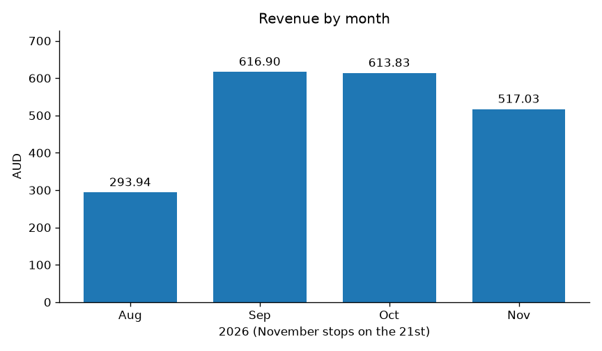
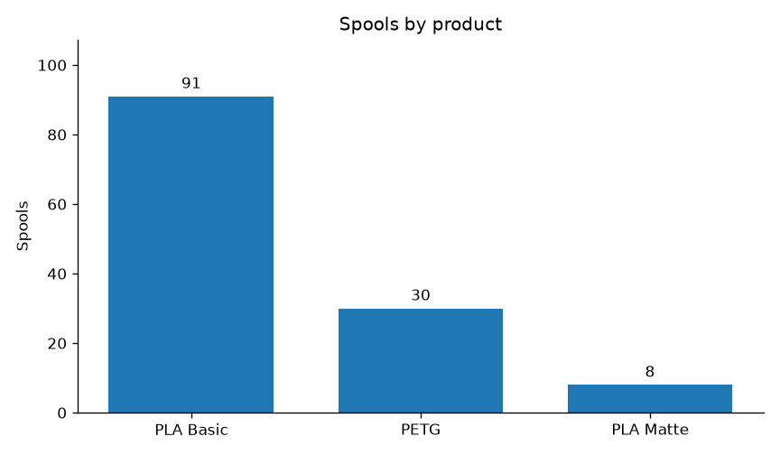
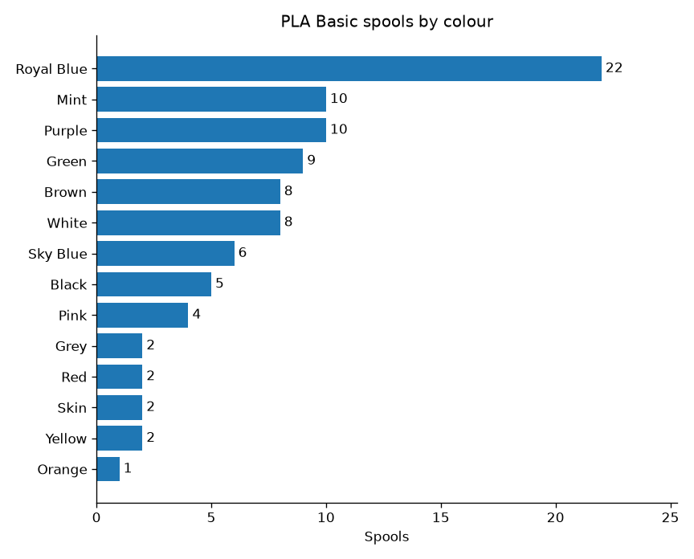
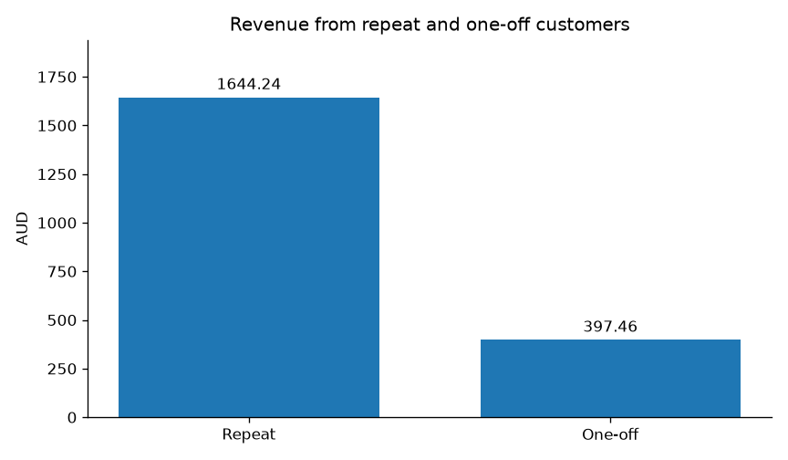
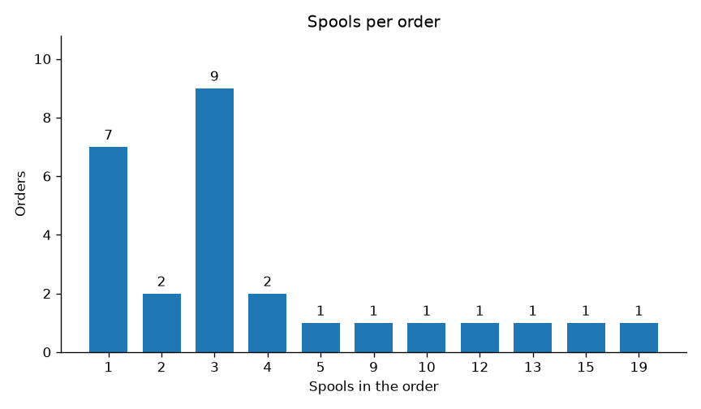

# TinyFab 3D, first few months

I run TinyFab 3D, a filament shop in Canberra (tinyfab3d.com.au). I sell 1kg spools of PLA Basic, PLA Matte, and PETG, and I deliver free around Canberra. Orders started in August 2026. I wanted to see what is actually selling after these first few months, before I place the next order. Sea freight from China takes about a month and a half, so a colour I buy too much of sits here for a long time.

The Shopify export in `data/` has 35 orders and 90 lines, from 2 Aug 2026 to 21 Nov 2026, in AUD. Eight of those orders are not sales, and I leave them out:

- 6 are Shopify test orders (`is_test` true). All of them are customer C01.
- 2 more are cancelled and refunded C01 orders. The product title is `test`: $1.00 on 2 Aug, and $0.01 on 24 Sep.

That leaves 27 paid orders, $2,041.70, from 16 customers. 27 orders is a small sample. Customer C02 spent $1,079.95 of that, so I am treating the figures below as a first look.

Region on an order is either `Canberra local` or a state code. The export has no postcodes and no customer names, and I am not adding any.

PLA Basic was renamed partway through. Early orders say "TinyFab PLA Basic Filament 1.75mm 1kg", later ones say "TinyFab PLA Basic 1.75mm 1kg". Same spool, so I count them together. On every real order the line totals add up to the order total. Shipping charged is $0.00. Discounts are $0.00.

## What the 27 orders show

September and October are the two full months, and they are almost the same. Each has 8 orders and 39 spools. September was $616.90, average order $77.11. October was $613.83, average $76.73. August, from the first real order on the 8th, was 4 orders, $293.94, 18 spools. The average is $73.49. That is $293.94 / 4, which is $73.485 before rounding to the cent. November is 7 orders, $517.03, 33 spools, average $73.86. The file stops on 21 Nov, so November is a partial month.

Over all 27 orders the average is $75.62. Customers bought 129 spools, 4.78 per order. The middle order is 3 spools. 7 orders were a single spool, 9 were three, and the largest was 19.

PLA Basic is 91 spools and $1,450.92. PETG is 30 spools and $446.86. PLA Matte is 8 spools and $143.92.

PLA Basic by colour:

| Colour | Spools | Revenue |
| --- | ---: | ---: |
| Royal Blue | 22 | $362.36 |
| Mint | 10 | $164.48 |
| Purple | 10 | $164.62 |
| Green | 9 | $148.27 |
| Brown | 8 | $131.78 |
| White | 8 | $106.54 |
| Sky Blue | 6 | $98.66 |
| Black | 5 | $66.92 |
| Pink | 4 | $65.68 |
| Yellow | 2 | $32.70 |
| Red | 2 | $32.98 |
| Skin | 2 | $32.98 |
| Grey | 2 | $26.60 |
| Orange | 1 | $16.35 |

White, black, and grey PLA Basic are the cheaper spools in the file, priced from $13.30 to $13.58. The other PLA Basic colours are $16.35 or $16.49. White and brown both sold 8 spools, and white brought in less money because of that price.

7 of the 16 customers came back. They placed 18 orders and $1,644.24, 80.53% of revenue. The other 9 ordered once, $397.46, 19.47%. C02's 5 orders are the $1,079.95 above, 52.89% of revenue. Where a customer did order again, there are 11 gaps between one order and the next. The average gap is 22.27 days, the median is 23, the shortest is 4, and the longest is 56.

26 orders are Canberra local, $2,005.72, 98.24% of revenue. One order is tagged NSW, $35.98, 1.76%.

## What I will put on the next order

Royal Blue PLA Basic first. 22 spools, and the next nearest colour is 10, with the boat about a month and a half out. Then Mint, Purple, Green, and Brown. For PETG I will buy less, White first (9 spools) and Silver next (5). Matte is 8 spools across the whole period, so only a few of those. And I will keep C02's $1,079.95 in mind before I assume next month looks like September or October.

## How to run it

```
pip install -r requirements.txt
make
```

`make` loads the two CSVs into SQLite, runs the queries in `sql/`, and writes the charts into `charts/`. `make test` checks that the exclusion leaves 27 orders and $2,041.70, plus the totals above. GitHub Actions runs those tests.










